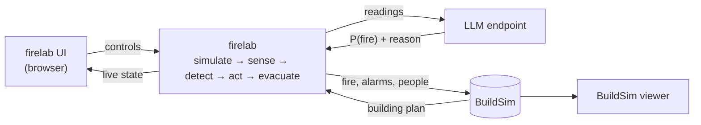

# firelab for the D7065E lab

firelab is the project: fire physics, sensing, an LLM-based fire detector
(with a hand-written fusion rule as fallback), the room agent, interlocks, and
evacuation. BuildSim is the provided environment it runs against; firelab reads
the building from it and publishes what it simulates back into it so the
BuildSim viewer can show it.



firelab reads the building from BuildSim, runs the simulation and the detector
(the LLM, with the fusion rule as fallback), and publishes what happens back to
BuildSim so its viewer shows it.

## 1. Configure the LLM detector

Create `firelab/.env` (ignored by git; shell exports win over the file):

```bash
LLM_BASE_URL=https://your-endpoint/v1   # any OpenAI-compatible chat endpoint
LLM_API_KEY=...
LLM_MODEL=the-model-your-endpoint-serves
FIRELAB_DETECTOR=llm                    # start with the LLM selected
```

Without `FIRELAB_DETECTOR=llm` firelab starts on the fusion rule; switch in the
settings panel or with `PUT /api/config {"detector": {"kind": "llm"}}`.

## 2. Start BuildSim, then firelab

```bash
# terminal 1: the building
cd buildingsim && make run

# terminal 2: firelab (first time: make build installs Python deps and the UI)
cd firelab && make build && make run
```

Open <http://127.0.0.1:8090> to control the simulation and
<http://127.0.0.1:9090> to watch the building react. firelab loads all three
floors when it starts; after restarting BuildSim, press *Reload* in firelab
(or `POST /api/reload`).

Both servers listen on 127.0.0.1 only. `make stop` in either folder stops a
server started in the background.

Do not run `occupancysim` at the same time: firelab replaces `/api/entities`
and `/api/occupancy` on every publish.

## 3. First run

1. **Sensor deployment**: tick a few rooms and press *Deploy*. The devices
   appear in BuildSim's equipment tree too.
2. **Scenario**: pick a room and a source (`flaming`, `smouldering`,
   `cooking`, `dust`, `steam`) and press *Ignite*, or use a preset.
3. Press **Run**. With the LLM detector the engine caps the speed at what the
   model keeps up with (typically a few times real time) and says so in the
   journal; on the fusion rule you can go to 30–60×.
4. Watch the **Rooms** table: truth, readings, P(fire), and alarm state side by
   side. Expand a row to inject a sensor fault (`stuck`, `dropout`, `drift`,
   `dead`). The journal shows the model's reason for each verdict.

How the LLM detector behaves:

- It is asked about one room at a time, most suspicious first, at most once
  per room every 10 simulated seconds, and only where something is happening.
- A verdict counts for 60 simulated seconds; after that, or while the model
  has not answered yet, the fusion rule scores the room. The journal records
  each hand-over.
- The alarm ladder and the interlocks are the same for both detectors, so a
  wrong answer from the model cannot trap anyone or release water without heat.

## 4. Tests and experiments

```bash
cd firelab
make test                                         # no services needed
.venv/bin/python experiments/run_experiments.py   # BuildSim must be running
.venv/bin/python experiments/containment.py
.venv/bin/python experiments/plot_results.py
.venv/bin/python experiments/compare_detectors.py # LLM vs rule; ~1 h, resumable
```

See [experiments/README.md](experiments/README.md) for what each result means.

## BuildSim endpoints firelab uses

| Direction | Endpoint | For |
|---|---|---|
| read | `GET /healthz` | connection status |
| read | `GET /api/building`, `GET /api/building/floors/{level}` | floors, rooms, walkable graph |
| read | `GET /api/building/cross-floor-edges` | stairs between floors |
| read | `GET /api/sessions` | the viewer session to highlight in |
| read | `GET /api/graph/route` | fallback escape route when firelab's own search finds none |
| write | `POST /api/equipment/bulk`, `DELETE /api/equipment/{id}` | deployed devices |
| write | `PUT /api/sensors/{id}/value` | each device's latest reading |
| write | `PUT /api/room-layers` | true temperature, smoke, CO, and P(fire) separately |
| write | `PUT /api/effects` | fire, smoke, sprinkler visuals |
| write | `PUT /api/alerts`, `PUT /api/doors` | alarms and fire-door state |
| write | `PUT /api/entities`, `PUT /api/occupancy` | occupants and where they are |
| write | `PUT /api/sessions/{id}/highlights`, `/route` | alarm colours and escape routes |

firelab's own API is listed in [README.md](README.md#api).

## Boundaries to state in the report

- BuildSim stores and renders current state; firelab owns the physics, sensing,
  detection, control logic, occupant movement, and history.
- Truth and belief go to different endpoints, so a false alarm is visible as a
  mismatch between the true-state layers and the P(fire) layer.
- Features are computed from readings only; nothing downstream of the sensors
  sees the truth. That includes the LLM: it is sent readings, never the
  simulation state.
- The LLM only estimates P(fire). It never issues commands; the agent and the
  interlocks decide what happens, and the fusion rule covers the room whenever
  the model is slow, wrong-shaped, or unreachable.
- The agent proposes commands; the interlocks decide whether they happen.
- The BuildSim viewer is provided infrastructure, not a firelab component.
